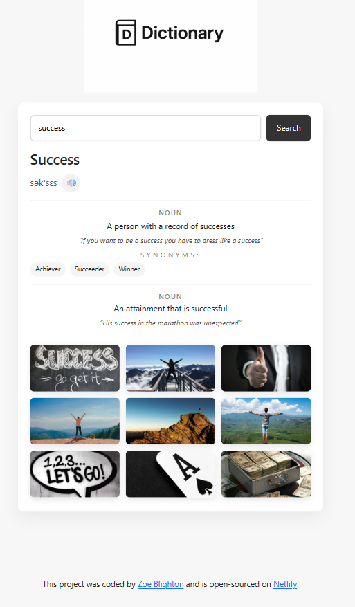

# Dictionary

Type a word and get its definitions, phonetics with pronunciation audio, synonyms and a gallery of related images. Two APIs are combined into one calm interface.

**[Live app →](https://enchanting-gingersnap-0e85cd.netlify.app/)**



## Built with

- **React 19** (Create React App) and plain CSS
- **Axios** for the API requests
- **SheCodes Dictionary API** for definitions, phonetics and synonyms
- **SheCodes Images API** for the photo gallery

## How it works

A search sends two requests: one for the definition and one for related images. The results are split into small components (`Results`, `Phonetics`), so each meaning, part of speech, synonym list and pronunciation renders independently.

## Run locally

```bash
npm install
npm start    # http://localhost:3000
```

Built during the SheCodes front-end development course.

---

By [Zoe Blighton](https://zoeblighton.com).
